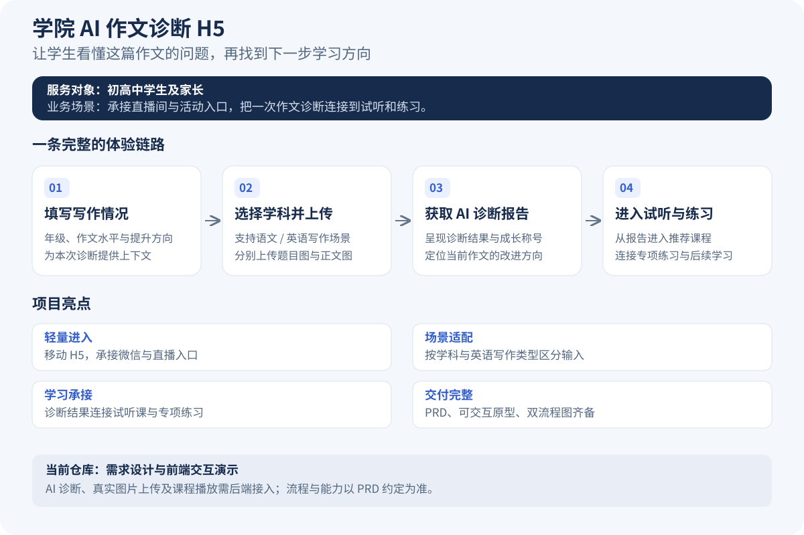

# 学院 AI 作文诊断 H5

面向初高中学生及家长的 AI 作文诊断 H5：通过作文诊断，连接个性化学习建议、试听课程与专项练习。

产品需求文档与交互原型归档，PRD 版本 V1.3。

## 查看文件

- [产品需求文档（PRD）](需求文档/学院AI作文诊断H5-PRD.html)
- [交互原型](原型/学院AI作文诊断H5-prototype.html)
- [业务流程图](流程图/学院AI作文诊断H5-flow.html)
- [交互流程图](流程图/学院AI作文诊断H5-screenflow.html)
- [AI 算法侧提需文档](需求文档/学院AI作文诊断H5-提需文档-AI算法侧.html)

下载完整仓库后，用浏览器打开 HTML。GitHub 文件页展示源码，不直接运行 HTML。请保持目录结构，以便 PRD 加载原型与流程图。

## 范围

这是需求与前端交互演示；上传、AI 诊断及视频播放不代表已接入生产服务。文档含历史待确认事项，以正文标注为准。

本归档移除了指向原电脑的保存服务配置及其导出客户端引用；保留正文和交互演示，本机“保存并通知 AI”等功能不包含在此归档中。未收录内部沟通记录、导出清单及机器配置。

