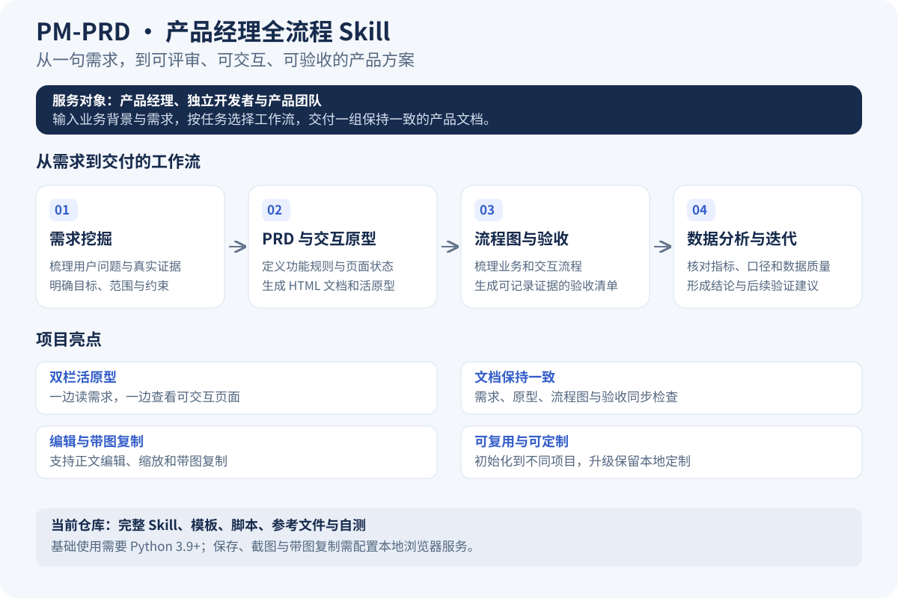

# PM-PRD · 产品经理全流程 Skill

edu-pm-workflow 是面向产品经理的工作流 Skill，覆盖需求挖掘、PRD、交互原型、流程图、验收清单和数据分析。适用于不同业务领域。

## 3.0 的重点

- 真实数据、用户转述、假设和模拟材料分别标注；没有来源就不生成市场结论。
- 数据分析先核对指标字典、观察窗口、去重口径和数据质量，再计算与解释。
- 验收采用待验收、通过、未通过、跳过四态，保留步骤、预期结果与证据。
- 公共文档组件提供编辑、双栏活原型、缩放、带图复制、保存和下载副本。
- 保存核对目标路径与原文件版本，覆盖前备份；重导出失败保留旧截图。
- 缓存追踪本地依赖、页面状态、视口和缩放，可强制刷新。
- 项目独立端口和凭据，默认只在本机开放，局域网分享使用只读模式。
- 精简工作流，组件与参考文件按需使用，升级保留本地定制。

## 快速开始

1. 将本仓库完整安装到 AI 助手的 Skill 目录，例如 Codex：

~~~sh
git clone https://github.com/zhaoxinfeng619-hub/PM-PRD.git ~/.codex/skills/edu-pm-workflow
~~~

调用名为 `edu-pm-workflow`。可直接说：“用 $edu-pm-workflow 帮我梳理需求，生成 PRD 和交互原型。”
2. 在目标项目目录中运行以下命令，将 /path/to/skill 替换成实际 Skill 路径：

~~~sh
python3 /path/to/skill/scripts/initialize.py --project .
~~~

macOS/Linux 也可从目标项目目录运行 bash /path/to/skill/scripts/init.sh。
初始化只复制规则、组件和模板，创建本机配置；不自动安装依赖或系统后台服务。

3. 直接描述需求，例如“先梳理内容发布流程的问题，确认后再写 PRD 和原型”。
4. 要使用保存、截图或带图复制，准备环境：

~~~sh
python3 scripts/start_service.py --install
python3 scripts/start_service.py --check
python3 scripts/start_service.py --serve
~~~

首次安装会下载 Playwright 1.60.0 和 Chromium，可能需要数分钟。下载进度和具体错误会在终端显示。
以后直接运行 --serve。macOS 也可双击项目根目录的启动原型导出服务.command。

## 支持环境

- 基础要求：Python 3.9+、现代桌面浏览器。--check 会实际启动 Chromium 检查就绪情况。
- macOS、Windows、Linux 均提供 Python 启动入口；Windows 可将命令里的 python3 换为 python。
- Linux 还需 Chromium 系统依赖，按 Playwright 安装提示处理；不同系统都应先运行 --check。
- macOS 后台启动器为可选项，依赖安装完成后运行 bash scripts/setup_prototype_export_watcher.sh。
- 后台启动器按项目独立注册。新版本不会自动停用已有旧版启动器，旧项目迁移后可自行停用不再使用的旧项。
- Pencil 为可选设计增强，连接方式按实际安装工具提供的说明设置，核心工作流不依赖它。

## 文档与原型

PRD 按需求大小裁剪章节，详细方案说明页面元素、交互、规则与适用边界。
使用 templates/prd-shell.html 和 scripts/build_prd.py 组装文档，公共编辑、复制和预览逻辑来自同一套组件。
左侧正文，右侧活原型，可切换页面、缩放和跟随正文定位；表格原型支持等比缩放。

复制全文会将正文中的原型和流程图变成内联图片。首次粘贴到目标文档时需确认图片是否保留，平台兼容性以实际结果为准。
服务或图片生成失败时保留缺图标记，显示失败数量，不静默丢图。
保存成功后需让 AI 读取文件，再同步相关产物；点击保存本身不会自动通知 AI。
下载副本会保存一份新的 HTML，不覆盖原文件。

## 项目结构

~~~text
[需求名]/
  需求文档/ 原型/ 流程图/
  原型截图/ 流程图截图/
  需求挖掘/ 验收清单/ 数据分析/
  沟通记录.md
.agents/workflows/     工作流定义与可选 local-overrides.md
.agents/references/    组件、图表及可选设计工具的参考
templates/            PRD 壳模板
scripts/              编辑、导出与环境检查工具
.pm-workflow/         本机配置、安装版本和待合并更新
.handoff/             备份及会话交接
~~~

同需求复用目录，只创建需要的子目录。没有需求池或新老需求自动分支功能。

## 升级与定制

运行同一条 initialize.py 命令更新。未定制的托管文件升级前留备份；改动过的文件保留原样，新版本放进 .pm-workflow/updates/，终端列出待合并项。
首次从旧版本升级时，没有安装清单的现有文件均按定制处理，需对照候选文件合并后再自测。
升级备份在 .handoff/skill-backups/，保存备份在 .handoff/html-backups/，截图覆盖备份在 .handoff/export-backups/。
旧 HTML 不会自动迁移。先备份，再按 .agents/references/pm-artifacts.md 接入新组件，避免运行两套监听器。
项目偏好建议写入 .agents/workflows/local-overrides.md，它不属于托管模板。
若移动或复制了项目目录，重新初始化以生成该目录的运行配置。

## 只读分享

~~~sh
python3 scripts/start_service.py --serve --read-only --host 0.0.0.0
~~~

先停止该项目的本机服务再切换模式。只读模式可浏览产物，不接受保存、截图生成或启动请求。
分享包保留产物和其必要本地资源，不包含 .pm-workflow/、.handoff/、scripts/.venv/ 或 scripts/pm-runtime-config.js。
本机配置含项目凭据，初始化已将其加入项目 .gitignore。
跨项目端口冲突会明确提示，不把其他项目服务当成当前服务。

## 自测

~~~sh
python3 -m pip install playwright==1.60.0
python3 -m playwright install chromium
python3 -m unittest discover -s tests -v
~~~

自测使用临时项目和本机临时服务，覆盖保存保护、导出失败、缓存失效、编辑恢复、复制、初始化与升级。不会修改已有项目产物。
